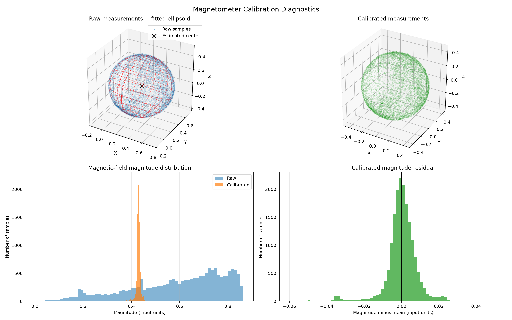
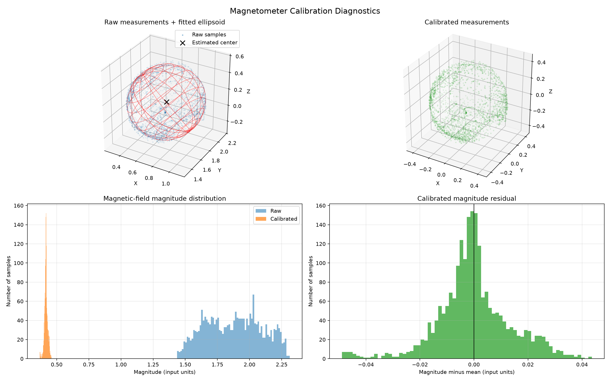
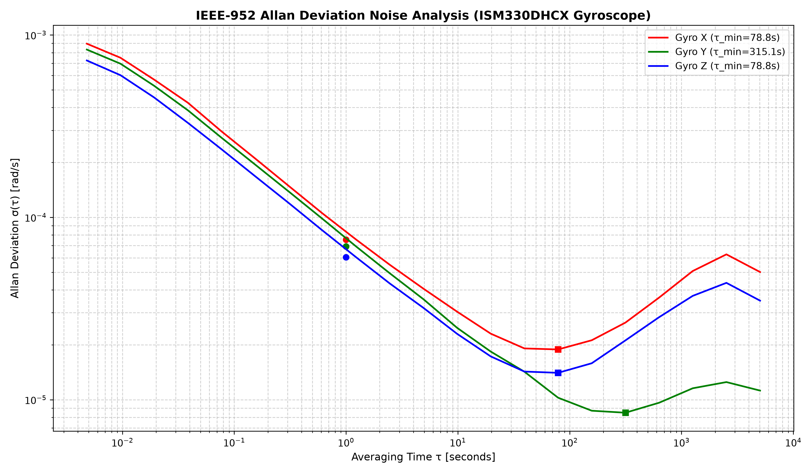

# 9-DOF Sensor Fusion AHRS with Calibration Pipeline & Allan Variance Characterization


## Short Introduction
This project was done under supervision of Assistant Teacher M.Sc. Dalila Fehratović. at the Department of Automation and Robotics, Faculty of Electrical Engineering, University of Tuzla. AHRS's are crucial components of moving robotic systems. An imperfection in their implementation and functioning can easily propagate through to other parts of the control system, and therefore have consequences ranging from harmless imprecise control to severe disasters. In theory, estimating attitude and heading can be done based on gyroscope data and information about the initial state. In practice, this is not enough, as sensors are imperfect in production and are often easily affected by their sorroundings. Calibration of the sensors can help eliminate these imperfections. Sensor fusion goes a step further and combines advantages of different sensors to provide a more precise estimate of the parameters of interest. Using a magnetometer, an accelerometer and a gyroscope gives the sensor + algorithm system 9 degrees of freedom to help estimate the output parameters of interest. Output parameters of interest are the attitude and heading. These can be presented using euler angles, more precisely pitch, roll and yaw, but this approach is less often used in comparison to determining attitude and heading using quaternions, as they eliminate the problem of gimbal lock.


## Approach
MEMS gyroscope, accelerometer and magnetometer are used for providing the 9 degrees of freedom. Calibration is performed for all sensors, including magnetometer soft-iron and hard-iron compensation, accelerometer scaling and bias compensation, and gyroscope bias compensation. The brain of the system is an STM development board with an MCU operating at a frequency of 168MHz. Quaternions are used for representing orientation, for reasons mentioned in the introduction. Sensor fusion is implemented by utilizing the Mahony Filter, a computationaly inexpensive and satisfyingly precise algorithm. A rocket-shaped casing was 3D printed and was assembled using steel bars and screws, to showcase the effects they have on the magnetometer and how can they be compensated for. Performance is charaterized by measuring algorithm and measurement latency using the DWT peripheral, measuring stationary drift, measuring startup transient behaviour, and profiling noise effects on the gryoscope using Allan Deviation Plots (Inspired by IEEE-952).

---

## Communications
For means of commmunication, SPI was chosen for both sensors. I2C provides sufficient bandwitdh, but the project will most likely be used as a component of larger robotics class projects in the future, hence SPI was the obvious choice for scalability and bandwidth.The device communicates with a PC over the USB OTG peripheral, providing high transfer speeds and seamless visualization. SPI runs in mode 3 for both sensors and at a frequency of 5.25MHz.

## Sensors
The sensors used are the ISM330DHCX IMU and the MMC5983MA magnetometer. You can acquire the sensor together on a breakout board on SparkFun. The axes on the respected breakout board are misaligned, in the sense that their z-axes point in different directions. This is compensated for in the uploaded code.


## MCU Unit
The microcontroller development board used was the STM32F407G-DISC 1. It features the 32-bit ARM Cortex-M4 and a maximum operating frequency of 168Hz, with a hardware floating-point unit (FPU), making it an excellent choice for this application.

---

## Sensor Calibration

### Accelerometer Calibration
The measurement model used for the accelerometer is:
$$
\mathbf{a}_m = \mathbf{S}_a \mathbf{a}_{true} + \mathbf{b}_a + \mathbf{n}_a
$$

Where:

- $\mathbf{a}_m$ – measured acceleration vector.
- $\mathbf{a}_{true}$ – true specific force vector.
- $\mathbf{S}_a$ – scale factor error matrix.
- $\mathbf{b}_a$ – accelerometer bias (offset) vector.
- $\mathbf{n}_a$ – measurement noise vector.

The bias and scale factor errors can be compensated for through calibration. Measurement noise cannot be removed entirely and can instead be reduced through filtering techniques.

Using the Python script described in the [How to Run](#how-to-run) section, the scale factor matrix and bias vector were determined. The corrected measurement model is given as:

$$
\mathbf{a}_{corrected} =
\mathbf{S}_a^{-1}
(\mathbf{a}_m - \mathbf{b}_a)
$$

The corrected measurements compensate for the accelerometer's bias and scale factor errors, retaining some measurement noise impact.


### Gyroscope Calibration

The measurement model used for the gyroscope is a simpler one:

$$
\boldsymbol{\omega}_m =
\boldsymbol{\omega}_{true}+\mathbf{b}_g+\mathbf{n}_g
$$

Where:

- $\boldsymbol{\omega}_m$ – measured angular velocity vector.
- $\boldsymbol{\omega}_{true}$ – true angular velocity vector.
- $\mathbf{b}_g$ – gyroscope bias (offset) vector.
- $\mathbf{n}_g$ – measurement noise vector.

The gyroscope bias can be estimated while the sensor is stationary and subsequently subtracted from the measurements. Measurement noise holds the same characteristics as it does for the accelerometer. The script used for estimating the bias is also mentioned in the [How to Run](#how-to-run) section.

The corrected measurement model is therefore given as:

$$
\boxed{
\boldsymbol{\omega}_{corrected}
=
\boldsymbol{\omega}_m-\mathbf{b}_g
}
$$

### Magnetometer Calibration

A more complete magnetometer model can account for various sources of measurement errors. This includes  effects originating externally to the sensor, and perhaps being dynamic. However, for this project, the model considering only hard-iron and soft-iron distortions was used.

The measurement model is:

$$
\mathbf{m}_m =
\mathbf{S}_{SI}\mathbf{m}_{true}
+\mathbf{b}_{HI}
$$

Where:

- $\mathbf{m}_m$ – measured magnetic field vector.
- $\mathbf{m}_{true}$ – true magnetic field vector.
- $\mathbf{S}_{SI}$ – soft-iron distortion matrix, representing distortions caused by nearby materials that alter the magnitude and direction of the measured magnetic field.
- $\mathbf{b}_{HI}$ – hard-iron bias vector, representing constant magnetic field offsets caused by permanently magnetized materials or magnetic components near the sensor.

The hard-iron and soft-iron distortions can be compensated for through calibration. Using the Python script described in the [How to Run](#how-to-run) section, the hard-iron bias vector and soft-iron distortion matrix were determined.

The corrected measurement model is therefore given as:

$$
\boxed{
\mathbf{m}_{corrected} =
\mathbf{S}_{SI}^{-1}
(\mathbf{m}_m-\mathbf{b}_{HI})
}
$$

The corrected measurements compensate for both hard-iron and soft-iron distortions, providing a more accurate representation of the Earth's magnetic field.

The same calibration method was used for the sensor in two scenarios:
- When the casing was free of materials that cause distortion
- When the casing was assembled using bars and screws

Different calibration parameters we expected, and sure enough the results of calibration matched that expectation. This is visible in Figure 1, where no distorting materials were present, and in Figure 2, where distorting materials were present.



<p align="center">Figure 1: Calibration results without distorting materials</p>

 Different estimations of the elipsoid occured, and the biases varied significantly. Precision of the calibration process itself changed, as we see the variance of calibrated samples rise when going from the experiment presented in Figure 1, to the one presented in Figure 2.



<p align="center">Figure 2: Calibration results with distorting materials</p>

The estimated magnetic north vector magnitude remained the same in both cases, close to the measured value by official institutions in Tuzla, Bosnia and Herzegovina. This can be an indicator of the calibration being successful.

---
## Mahony Filter Sensor Fusion

The Mahony filter (an explicit complementary filter) is a deterministic and computationally efficient AHRS algorithm. It's a dynamic fusion of high frequency gyroscope angular rate updates  and low frequency vector measurements from the accelerometer (gravity reference) and the magnetometer (magnetic north reference).


Extended Kalman Filters (EKF) mandate intensive matrix calculations, while the Mahony filter formulates orientation error in the body frame via vector cross-products. This error is fed into a Proportional-Integral (PI) controller to compensate for gyroscope bias drift in real time before integrating angular velocity into a normalized orientation quaternion.


### Algorithmic Pipeline

The core filter loop executes at each sample step $\Delta t$ through four sequential steps:
1. **Measurement Normalization:** Normalizing raw accelerometer and magnetometer vectors.
2. **Body-Frame Error Calculation:** Computing orientation error via vector cross-products between observed and estimated fields.
3. **PI Bias Correction:** Correcting measured angular velocity using proportional and integral feedback.
4. **Kinematic Integration & Normalization:** Integrating corrected angular rates into the orientation quaternion and enforcing unit magnitude.

---

### Vector Error Cross-Product Formulation

Let the current orientation estimate be represented by the unit quaternion $\mathbf{q} = [q_0, q_1, q_2, q_3]^T$.

Raw, calibrated measurements from the accelerometer ($\mathbf{a}_{corrected}$) and magnetometer ($\mathbf{m}_{corrected}$) are first normalized to unit vectors:

$$
\hat{\mathbf{a}} = \frac{\mathbf{a}_{corrected}}{\|\mathbf{a}_{corrected}\|}, \quad \hat{\mathbf{m}} = \frac{\mathbf{m}_{corrected}}{\|\mathbf{m}_{corrected}\|}
$$

The expected gravity vector in the body frame, $\hat{\mathbf{v}} = [v_x, v_y, v_z]^T$, is obtained by rotating the Earth-frame gravity vector $\hat{\mathbf{g}} = [0, 0, 1]^T$ by the inverse of quaternion $\mathbf{q}$:

$$
\hat{\mathbf{v}} = \begin{bmatrix} 2(q_1 q_3 - q_0 q_2) \\ 2(q_0 q_1 + q_2 q_3) \\ q_0^2 - q_1^2 - q_2^2 + q_3^2 \end{bmatrix}
$$

The accelerometer orientation error $\mathbf{e}_a$ is the vector cross-product between the measured gravity direction $\hat{\mathbf{a}}$ and predicted gravity direction $\hat{\mathbf{v}}$:

$$
\mathbf{e}_a = \hat{\mathbf{a}} \times \hat{\mathbf{v}} = \begin{bmatrix} a_y v_z - a_z v_y \\ a_z v_x - a_x v_z \\ a_x v_y - a_y v_x \end{bmatrix}
$$

---

### Magnetometer Earth-Frame Tilt Compensation

Computing the cross product of $\hat{\mathbf{m}}$ with the ideal Earth magnetic field vector introduces errors due to the magnetic vector's vertical component. To separate pitch and roll errors from yaw estimation, the measured magnetic vector $\hat{\mathbf{m}}$ is initially rotated into the intermediate Earth frame $\mathbf{h} = [h_x, h_y, h_z]^T$:


$$

\mathbf{h} = \mathbf{q} \otimes \begin{bmatrix} 0 \\ \hat{\mathbf{m}} \end{bmatrix} \otimes \mathbf{q}^*

$$


To remove distortions caused by the vertical component, the Earth magnetic reference vector $\mathbf{b} = [b_x, 0, b_z]^T$ is obtained by setting the $y$-axis component to zero and aligning the horizontal magnetic field with the $x$-axis:


$$

b_x = \sqrt{h_x^2 + h_y^2}, \quad b_z = h_z

$$


Afterward, this reference field $\mathbf{b}$ is rotated back into the body frame to generate the expected magnetic direction vector $\hat{\mathbf{w}} = [w_x, w_y, w_z]^T$:


$$

\hat{\mathbf{w}} = \begin{bmatrix} 2b_x(0.5 - q_2^2 - q_3^2) + 2b_z(q_1 q_3 - q_0 q_2) \\ 2b_x(q_1 q_2 - q_0 q_3) + 2b_z(q_0 q_1 + q_2 q_3) \\ 2b_x(q_0 q_2 + q_1 q_3) + 2b_z(0.5 - q_1^2 - q_2^2) \end{bmatrix}

$$


The magnetometer error $\mathbf{e}_m$ is determined using the cross product:


$$

\mathbf{e}_m = \hat{\mathbf{m}} \times \hat{\mathbf{w}}

$$


The total error $\mathbf{e}$ is calculated as the sum of the two sensor components:


$$

\mathbf{e} = \mathbf{e}_a + \mathbf{e}_m

$$

---

### Kinematic Quaternion Rate Integration

The total error vector $\mathbf{e}$ is processed by a PI compensator to produce the corrected angular velocity vector $\boldsymbol{\omega}_{corr}$:

$$
\boldsymbol{\omega}_{corr} = \boldsymbol{\omega}_{corrected} + K_p \mathbf{e} + K_i \int_0^t \mathbf{e}(\tau) \, d\tau
$$

where $K_p$ is the proportional feedback gain and $K_i$ is the integral feedback gain responsible for estimating gyroscope bias drift.

The continuous quaternion rate of change is governed by the kinematic differential equation:

$$
\dot{\mathbf{q}} = \frac{1}{2} \mathbf{q} \otimes \mathbf{p}(\boldsymbol{\omega}_{corr})
$$

where $\mathbf{p}(\boldsymbol{\omega}) = [0, \omega_{x,corr}, \omega_{y,corr}, \omega_{z,corr}]^T$.

In discrete time, integration over sampling period $\Delta t$ uses a first-order Euler step followed by normalization to guarantee $\mathbf{q} \in \mathbb{S}^3$:

$$
\mathbf{q}_{k+1} = \mathbf{q}_k + \dot{\mathbf{q}}_k \Delta t
$$

$$
\mathbf{q}_{k+1} \leftarrow \frac{\mathbf{q}_{k+1}}{\|\mathbf{q}_{k+1}\|}
$$

---

### Transfer Function Derivation & Frequency-Domain Behavior

To analyze how the filter divides control authority between sensors, we consider a 1D linearized model around small angles. Let $\theta$ be the true orientation angle, $\theta_{ref}$ be the vector-derived angle observation (accelerometer/magnetometer), and $\omega_m = \dot{\theta} + n_g$ be the gyroscope angular rate measurement.

The feedback loop equation in the continuous Laplace domain ($s$):

$$
\theta(s) = \frac{1}{s} \left[ \omega_m(s) + K_p \left( \theta_{ref}(s) - \theta(s) \right) + \frac{K_i}{s} \left( \theta_{ref}(s) - \theta(s) \right) \right]
$$

Algebraic manipulation leads to:

$$
\theta(s) = \underbrace{\frac{s}{s^2 + K_p s + K_i}}_{H_{gyro}(s)} \omega_m(s) + \underbrace{\frac{K_p s + K_i}{s^2 + K_p s + K_i}}_{H_{ref}(s)} \theta_{ref}(s)
$$

Noting that the integrated rate satisfies the pure integration $\theta_{gyro}(s) = \frac{1}{s} \omega_m(s)$ (meaning $\omega_m(s) = s \cdot \theta_{gyro}(s)$), we can express the output directly in terms of angles:

$$
\theta(s) = \left( s \cdot H_{gyro}(s) \right) \theta_{gyro}(s) + H_{ref}(s) \theta_{ref}(s)
$$

Thus, the effective angle-domain transfer functions fulfill the standard complementary property:

$$
H_{ref}(s) + s \cdot H_{gyro}(s) = \frac{K_p s + K_i}{s^2 + K_p s + K_i} + \frac{s^2}{s^2 + K_p s + K_i} = 1
$$

Evaluating the frequency response ($s = j\omega$):

- High Frequencies ($\omega \gg \omega_c$): $H_{ref}(j\omega) \to 0$ and $s \cdot H_{gyro}(j\omega) \to 1$. The gyroscope integrated angle dominates orientation control, while high-frequency noise from the accelerometer/magnetometer vector observations is attenuated.
- Low Frequencies ($\omega \ll \omega_c$): $H_{ref}(j\omega) \to 1$ and $s \cdot H_{gyro}(j\omega) \to 0$. The accelerometer and magnetometer dominate, actively correcting gyroscope bias and drift.

The crossover frequency $\omega_c$ separating these operational regions is dictated by the observer gains. For a second-order PI filter structure, the bandwidth transition is primarily shaped by $K_p$ (under the assumption that $K_p >> K_i$):

$$
\omega_c \approx K_p \quad (\text{rad/s})
$$

---

## Parameter Tuning
In terms of classical control theory, the integrator reset time of a PI controller is:
$$
Ti = \frac{Kp}{Ki}
$$

Mathematically and physically, it identifies the time needed for the integrator component to produce a signal equivalent to the proportional component's immediate reaction to a constant and persistent error.

The proportional gain $K_p$ was set to 2.0 to set an appropriate crossover frequency. By a good convention, the integrator gain $K_i$ was initially set to $K_i = \frac{K_p}{100}$, and was later experimentally and by exploring other conventions tuned to $K_p = 0.0137$. It has shown to be a value appropriate for tracking gyroscope bias changes caused by random walk processes, and also appropriate for avoiding overshoot caused by the integrator component.

---
## Initialization & Orientation Convergence Benchmarking

To ensure instant flight readiness upon system power-on, the AHRS architecture implements an algebraic static alignment routine (`Mahony_Init`) executed prior to enabling the $208\text{ Hz}$ update loop.

Cold-start convergence latency was profiled by tracking the Mahony vector error norm ($e_{\text{norm}}^2 = e_x^2 + e_y^2 + e_z^2$) until residual orientation error stabilized below $0.0001\text{ rad}^2$ ($\approx 0.57^\circ$) for 20 consecutive frames.

### Convergence Benchmark Results

| Test Condition | Initial State Definition | Convergence Threshold | Measured Transient Time ($T_{\text{settled}}$) | Latency Reduction |
| :--- | :--- | :--- | :--- | :--- |
| **Cold Start (Without Init)** | Identity Quaternion $[1, 0, 0, 0]^T$ | $< 0.0001\text{ rad}^2$ | **$17,493\text{ ms}$** ($17.49\text{ s}$) | Baseline |
| **Static Alignment (With Init)** | Triad Vector Cross-Product Math | $< 0.0001\text{ rad}^2$ | **$86\text{ ms}$** ($0.086\text{ s}$) | **$99.51\%$ Reduction** ($203.4\times$ faster) |

---

## Embedded Hardware Benchmarking

Timing was measured on an **STM32F407VG running at 168 MHz** (8 MHz HSE + PLL) with the single-precision FPU enabled (`-mfpu=fpv4-sp-d16 -mfloat-abi=hard`). Execution times were captured on hardware with the Cortex-M4 **DWT cycle counter (`DWT->CYCCNT`)** and converted to microseconds at 168 MHz.

### System timing

- The ISM330DHCX runs at a nominal 208 Hz and raises a pulsed data-ready interrupt on INT1, giving a frame period of 1/208 s = 4,807.7 µs. The ISR only sets a flag; sensor reads and the Mahony update runs in the main loop.
- The MMC5983MA is triggered every third IMU frame (≈ 69.3 Hz) with a 4 ms conversion time. The main loop polls the Meas_M_Done flag and reads the result once it is set.
- Both sensors share SPI2 (5.25 MHz, mode 3) with separate chip-select lines.

### Measured execution time

| Function | Time (µs) | % of 4,807.7 µs frame |
| :--- | :--- | :--- |
| `ISM_Read_Data` (13-byte SPI burst + unit conversion and calibration) | 51.1 (observed max) | 1.06% |
| `MMC_Read_Data` (8-byte SPI burst + calibration, every 3rd frame) | 45.1 (observed max) | 0.94% |
| `Mahony_Update` | 8.42 | 0.18% |
| Idle main-loop pass (no work pending) | 0.35 – 0.82 | n/a |

Sum of the observed maxima: **59.5 µs (1.24%)** for a frame without a magnetometer sample, and **104.7 µs (2.18%)** for a frame with one. Times are wall-clock, so they include any interrupt that preempts the function. The figures exclude the magnetometer trigger write, the STATUS polling reads and the USB telemetry.

### Floating point

The filter and sensor drivers use `float` and the single-precision math functions (`sqrtf`, `atan2f`, `sinf`, …), and the project filter is built for the Cortex-M4 single-precision FPU with the hard-float ABI.

## Stationary Long-Term Drift Verification

To evaluate steady-state observer stability and assess whether the online bias estimator ($K_i$) prevents thermal divergence, a static 22-minute ($1,320\text{s}$) orientation hold test was executed hardware-in-the-loop.

### 22-Minute Drift Metrics

| Parameter | Initial State ($t = 0\text{m}$) | Final State ($t = 22\text{m}$) | Total Drift | Normalized Drift Rate |
| :--- | :--- | :--- | :--- | :--- |
| **Quaternion ($w, x, y, z$)** | `[0.6289, -0.2223, 0.6997, 0.2556]` | `[0.6271, -0.2268, 0.6984, 0.2595]` | $\Delta \theta \approx 0.745^\circ$ | **$\approx 2.032^\circ / \text{hr}$** |
| **Roll ($\phi$)** | $135.027^\circ$ | $135.216^\circ$ | $+0.189^\circ$ | $0.516^\circ / \text{hr}$ |
| **Pitch ($\theta$)** | $83.657^\circ$ | $83.640^\circ$ | $-0.017^\circ$ | $0.046^\circ / \text{hr}$ |
| **Yaw ($\psi$)** | $174.594^\circ$ | $175.510^\circ$ | $+0.916^\circ$ | $2.498^\circ / \text{hr}$ |
e
### Technical Analysis

1. **Observer Convergence Horizon:** The 22-minute logging duration spans **$8.38 \times \bar{\tau}_b$** relative to the empirical bias correlation time horizon ($\bar{\tau}_b = 157.54\text{s}$), where $\bar{\tau}_b$ represents the physical bias correlation time discussed in the next section. This duration provides more than eight bias correlation periods over which to evaluate orientation stability. The bounded orientation drift is consistent with stable observer operation.

2. **Axis Decoupling:** Roll and pitch exhibited limited angular variation, remaining within approximately $0.19^\circ$ and $0.02^\circ$, respectively. This behavior is consistent with continuous gravity-vector corrections constraining the tilt estimates. Yaw exhibited a total drift of $0.916^\circ$, corresponding to approximately $2.498^\circ/\text{hr}$. This drift remained below the $2.5^\circ/\text{hr}$ threshold, consistent with effective heading stabilization through magnetometer fusion.


## Empirical Allan Variance Characterization

While manufacturer datasheets specify baseline white noise density ($N_g$) and bias instability ($B_g$), they cannot provide the physical bias correlation time horizon ($\tau_b$). Because $\tau_b$ is an environmental system metric governed by PCB thermal dissipation, layout, etc., long-term static logging on the physical hardware was required. Performing Allan Variance characterization allows extracting the true empirical instability time scale ($\bar{\tau}_b = 157.54\text{s}$), which can besides noise profiling be used to help determine optimal $K_i$ values.



### Sensor Noise Profile & Interpretation

The log-log Allan Deviation plot illustrates three distinct operational noise regimes across the ISM330DHCX tri-axis gyroscope:

1. **Angle Random Walk (ARW / White Noise Floor, $\tau < 1\text{s}$):**  
   High-frequency thermo-mechanical noise dominates the left downward slope. Sampled at $\tau = 1.0\text{s}$, the white noise density ranges from $6.04 \times 10^{-5}\ \text{rad/s}/\sqrt{\text{Hz}}$ (Gyro Z) to $7.55 \times 10^{-5}\ \text{rad/s}/\sqrt{\text{Hz}}$ (Gyro X), placing all three axes cleanly inside the factory datasheet specification ($3.8$ to $5.8\text{ mdps}/\sqrt{\text{Hz}}$).

2. **In-Run Bias Instability ($B_g$ & $\tau_b$):**  
   The minimum turning point of each curve represents the flicker noise floor, the absolute maximum measurement precision achievable by averaging white noise before thermal drift takes over.
   * **Gyro X & Z:** Reach peak stability at $\tau_b = 78.8\text{s}$.
   * **Gyro Y:** Demonstrates superior thermal stability on the PCB, reaching a lower bias instability floor ($8.48 \times 10^{-6}\ \text{rad/s}$) at $\tau_b = 315.1\text{s}$.
   * **Tri-Axis Mean ($\bar{\tau}_b$):** The average instability time horizon across all axes is **$157.54\text{ seconds}$** ($\sim 2.6\text{ minutes}$), yielding an average bias floor of $2.85^\circ/\text{hr}$ (mirroring ST's $3.0^\circ/\text{hr}$ rating).

3. **Rate Random Walk / Thermal Drift ($\tau > 300\text{s}$):**  
   Beyond $\tau_b$, internal thermal effects cause the deviation curves to turn upward, marking the boundary where uncompensated raw gyro signals drift rapidly away from true angular velocity.

### Allan Deviation Metrics Summary

| Axis | Angle Random Walk $N_g$ [rad/s/$\sqrt{\text{Hz}}$] | Bias Instability $B_g$ [rad/s] | Instability Time Horizon $\tau_b$ [s] |
| :--- | :--- | :--- | :--- |
| **Gyro X** | $7.552 \times 10^{-5}$ | $1.886 \times 10^{-5}$ | $78.8\text{s}$ |
| **Gyro Y** | $6.920 \times 10^{-5}$ | $8.485 \times 10^{-6}$ | $315.1\text{s}$ |
| **Gyro Z** | $6.042 \times 10^{-5}$ | $1.404 \times 10^{-5}$ | $78.8\text{s}$ |
| **Tri-Axis Mean** | **$6.838 \times 10^{-5}$** | **$1.379 \times 10^{-5}$** | **$157.54\text{s}$** |

## Hardware Configuration & Pinout

The system interfaces an **STM32F407** MCU with a **SparkFun 9DoF Breakout Board** (housing the ISM330DHCX 6-DoF IMU and MMC5983MA 3-axis magnetometer) over a shared hardware SPI bus with independent interrupt lines and chip selects:

| STM32 Pin | Peripheral / Mode | Breakout Pin | Signal Function |
| :--- | :--- | :--- | :--- |
| **PB6** | EXTI Line Input | `INT1` | ISM330DHCX Data-Ready Interrupt (208 Hz Master Clock) |
| **PB10** | SPI2 SCK | `SCL` / `SCK` | Shared Serial Clock |
| **PB12** | GPIO Output | `ACS` | ISM330DHCX Accelerometer/Gyro Chip Select (Active Low) |
| **PB13** | GPIO Output | `MCS` | MMC5983MA Magnetometer Chip Select (Active Low) |
| **PC2** | SPI2 MISO | `POCI` | Master In Slave Out (Data to MCU) |
| **PC3** | SPI2 MOSI | `PICO` | Master Out Slave In (Data to Sensor) |
| **3V3 / GND** | Power Supply | `3V3` / `GND` | Target logic voltage and reference ground |

---

## Repository Structure

```text
.
├── .gitignore                      # Git exclusion rules for build artifacts & temp files
├── 9dof_estimator2.ioc             # STM32CubeMX peripheral & clock configuration project
├── STM32F407VGTX_FLASH.ld          # Memory map linker script for Flash execution
├── STM32F407VGTX_RAM.ld            # Linker script for RAM execution
├── Makefile                        # GNU Arm Embedded Toolchain build definition
│
├── BENCHMARK/                      # DWT cycle-counter execution benchmarking
│   ├── benchmark.c
│   └── benchmark.h
├── CONFIG/                         # System initialization & error handler routines
│   ├── error.c
│   ├── error.h
│   ├── peripheral.c
│   └── peripheral.h
├── Core/                           # Application logic, interrupts, and HAL main setup
│   ├── Inc/
│   │   ├── main.h
│   │   ├── stm32f4xx_hal_conf.h
│   │   └── stm32f4xx_it.h
│   ├── Src/
│   │   ├── main.c                  # Main measurement loop & state machine
│   │   ├── stm32f4xx_hal_msp.c
│   │   ├── stm32f4xx_it.c
│   │   ├── syscalls.c
│   │   ├── sysmem.c
│   │   └── system_stm32f4xx.c
│   └── Startup/
│       └── startup_stm32f407vgtx.s # Cortex-M4 startup vector table
│
├── Drivers/                        # CMSIS Core and STM32F4xx HAL Driver Library
├── FUSION/                         # Mahony AHRS Sensor Fusion filter implementation
│   ├── fusion.c
│   └── fusion.h
├── Middlewares/                    # ST USB Device Library (CDC Class)
├── SENSOR/                         # Hardware drivers for ISM330DHCX & MMC5983MA
│   ├── ism330dhcx.c
│   ├── ism330dhcx.h                # Stores calibration coefficients & bias matrices
│   ├── mmc5983ma.c
│   └── mmc5983ma.h                # Stores hard/soft-iron magnetometer matrices
├── SPI/                            # SPI peripheral transaction layer
│   ├── spi.c
│   └── spi.h
├── USB/                            # Non-blocking USB CDC CDC_Transmit_FS wrapper
│   ├── misc.c
│   ├── misc.h
│   ├── usb.c
│   └── usb.h
├── USB_DEVICE/                     # USB CDC configuration files & descriptors
│
├── calibration/                    # Host-side Python calibration & analysis harness
│   ├── accel_calibration.py        # 6-position static accelerometer calibration
│   ├── gyro_calibration.py         # Zero-rate offset static bias calibration
│   ├── mag_logger.py               # Real-time 3D plot & CSV sample collection logger
│   ├── mag_calibration1.py         # Ellipsoid least-squares hard/soft iron solver
│   └── allan_deviation.py          # IEEE-952 Allan Variance noise characterization
│
├── docs/                           # Datasheets and visualizer script
│   └── quaternion.html             # Browser-based 3D orientation visualizer
└── README.md
```
## Offline Analysis & Tooling Dependencies

The scripts located in `calibration/` process raw USB CDC serial streams from the STM32 board to compute calibration parameters and noise statistics.

| Library / Tool | Primary Purpose | Used In |
| :--- | :--- | :--- |
| **`pyserial`** | Serial port communication (`/dev/ttyACM*`) | `accel_calibration.py`, `gyro_calibration.py`, `mag_logger.py`, `allan_deviation.py`|
| **`numpy`**| Array transformations and statistical computations | All Python calibration scripts |
| **`scipy`** | `least_squares` non-linear optimization for ellipsoid fitting | `mag_calibration1.py`|
| **`matplotlib`**| Live 3D point cloud rendering and diagnostic plot generation | `mag_logger.py`, `mag_calibration1.py`, `allan_deviation.py`|
| **`allantools`**| Overlapping Allan Deviation (`oadev`) computation| `allan_deviation.py` |

Install all host dependencies via `pip`:

```bash
pip install pyserial numpy scipy matplotlib allantools
```

### Calibration & Real-Time Visualization Workflow

Calibration parameters are derived by configuring `Core/Src/main.c` to output uncalibrated sensor data over USB CDC, running the corresponding Python script, and pasting the computed constants into the driver header files (`SENSOR/ism330dhcx.h` and `SENSOR/mmc5983ma.h`).

#### Step 1: Accelerometer Calibration
1. Open `Core/Src/main.c`. Comment out `Mahony_Update` and the quaternion output `USB_Print("%f, %f, %f, %f\r\n", ...)`.
2. Uncomment the uncalibrated accelerometer data stream:
   ```c
   ISM_Read_Data_NonCalibrated(accel_g, gyro_rads);
   USB_Print("%f, %f, %f\r\n", accel_g[0], accel_g[1], accel_g[2]);
   ```
3. Recompile, flash firmware, and run the 6-position calibration script:
   ```bash
   python3 calibration/accel_calibration.py
   ```
4. Place the sensor flat in all 6 principal orientations (`+Z`, `-Z`, `+Y`, `-Y`, `+X`, `-X`) as prompted.
5. Update `SENSOR/ism330dhcx.h` with the printed scale factor and bias vector values.

#### Step 2: Gyroscope Zero-Rate Bias Calibration
1. Keep the uncalibrated data stream active in `Core/Src/main.c` (gyro outputs are streamed in degrees per second).
2. Keep the board completely still on a flat surface and execute:
   ```bash
   python3 calibration/gyro_calibration.py
   ```
3. Copy the formatted C array printed in the console into `SENSOR/ism330dhcx.h`:
   ```c
   const float gyro_bias[3] = { bias_x, bias_y, bias_z };
   ```

#### Step 3: Magnetometer Hard-Iron / Soft-Iron Calibration
1. In `Core/Src/main.c`, comment out the IMU stream and uncomment the uncalibrated magnetometer data stream:
   ```c
   // MMC_Read_Data(m_gauss);
   MMC_Read_Data_NonCalibrated(m_gauss);
   USB_Print("%f, %f, %f\r\n", m_gauss[0], m_gauss[1], m_gauss[2]);
   ```
2. Recompile and flash firmware.
3. Run `mag_logger.py` to stream raw measurements into a 3D plot and save a CSV file:
   ```bash
   python3 calibration/mag_logger.py
   ```
4. Rotate the sensor in a full sphere through all 3D orientations until the scatter plot forms a uniform sphere/ellipsoid. Close the plot window to save the log file inside `mag_data/mag_YYYYMMDD_HHMMSS.csv`.
5. Execute the non-linear least-squares ellipsoid solver on the generated CSV file:
   ```bash
   python3 calibration/mag_calibration1.py mag_data/mag_20261026_103000.csv
   ```
6. Update `SENSOR/mmc5983ma.h` with the hard-iron offset vector and 3x3 soft-iron correction matrix output by `mag_calibration.json`.

#### Step 4: Long-Term Gyroscope Allan Variance Characterization (Optional)
To determine the sensor's Angle Random Walk ($N_g$), Bias Instability ($B_g$), correlation time horizon ($\tau_B$):
1. Leave the sensor stationary for 4 hours while running:
   ```bash
   python3 calibration/allan_deviation.py
   ```
2. The script logs data, computes the IEEE-952 Overlapping Allan Deviation and saves `allan_variance_analysis.png`.

#### Step 5: Normal Operation & 3D Visualization
1. In `Core/Src/main.c`, comment out all uncalibrated output lines and uncomment calibrated reads along with the fusion pipeline:
   ```c
   MMC_Read_Data(m_gauss);
   Mahony_Update(q, accel_g, gyro_rads, m_gauss, mag_data_ready);
   USB_Print("%f, %f, %f, %f\r\n", q[0], q[1], q[2], q[3]);
   ```
2. Recompile and flash the final production build.
3. Launch a Chromium-based browser (Chrome or Edge) and open `docs/quaternion.html`.
4. Click **Connect Serial**, select the STM32 Virtual COM Port (`/dev/ttyACM*`), and inspect real-time 3D orientation rendering.

## Tooling Acknowledgments
The focus of the project is developing an embedded system suited to function as a sub-component of a robotic system and understanding the underlying mathematics and physics. External calibration and evaluation tools include:

* **Host-Side Calibration & Analysis Suite:** The offline Python utility scripts in `calibration/` (covering 3D point cloud logging, non-linear ellipsoid fitting, and IEEE-952-inspired Allan Variance analysis) were integrated from open-source reference algorithms into the project's hardware verification pipeline.
* **Real-Time 3D Visualizer:** The browser-based WebSerial quaternion rendering tool (`docs/quaternion.html`) was adapted from open-source WebGL reference implementations to validate real-time orientation estimates over USB CDC.
* **Third-Party Libraries:** Built using public scientific Python packages including `allantools`, `scipy.optimize`, `matplotlib`, and `pyserial`.
